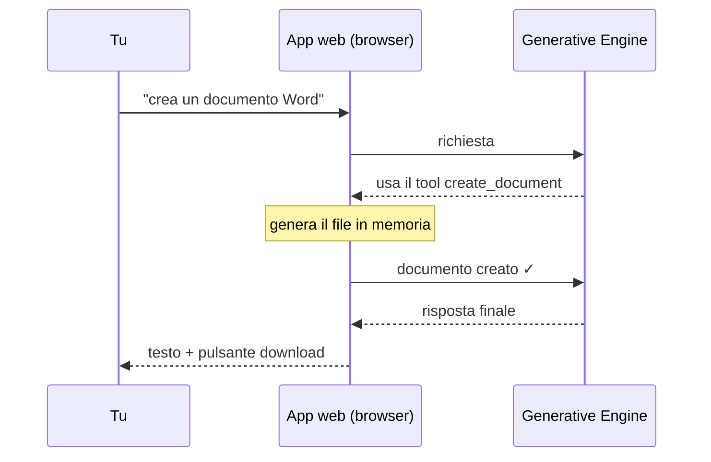
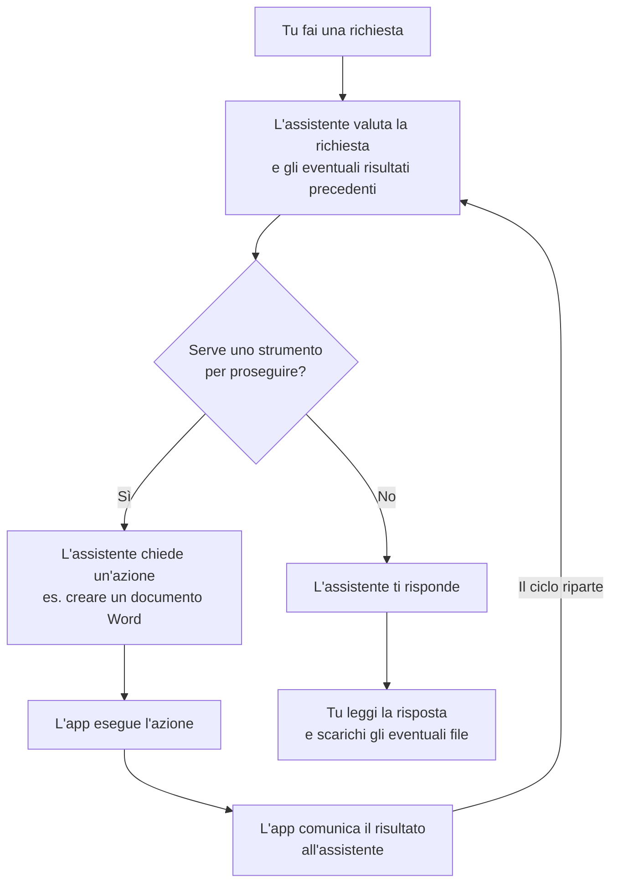

# Step 4 — Agente con Tool Calling

Assistente agentico completo con ciclo iterativo, tool calling e generazione di documenti PDF, Word ed Excel scaricabili direttamente dall'interfaccia.



---

## Come funziona il ciclo dell'assistente

Un chatbot risponde con un testo. Un **agente** può anche chiedere all'app di svolgere un'azione, per esempio creare un file Word, e usare il risultato per proseguire.

Questo giro si chiama **ciclo agentico**: l'assistente decide il prossimo passo, l'app esegue l'azione e gli comunica il risultato. A quel punto l'assistente può chiedere un'altra azione oppure dare la risposta finale.



**Esempio:** chiedi «Crea un documento Word con un piano d'azione». L'assistente prepara il contenuto e chiede all'app di creare il file. L'app lo genera e comunica l'esito all'assistente, che può quindi risponderti. Nell'interfaccia trovi il documento da scaricare.

Non devi seguire ogni passaggio: fai la richiesta e leggi il risultato. In questa demo il ciclo ha un limite di **5 giri**, per evitare che continui all'infinito.

---

## Cosa fa

- **Ciclo agentico**: l'assistente può alternare richieste di azioni e lettura dei risultati prima di rispondere
- **Uso di strumenti (tool calling)**: l'assistente decide quando chiedere all'app di creare un documento
- **Generazione documenti**: PDF, DOCX e XLSX generati in memoria e scaricabili
- **Knowledge base**: upload di file PDF/Word/Excel come contesto per le risposte
- **Status panel**: mostra in tempo reale i passi intermedi dell'elaborazione

## File

```
app.py          # interfaccia Streamlit con status panel e download button
config.py       # API key, modello, MAX_TOKENS
engine.py       # agentic loop + tool calling + gestione eventi
generator.py    # generazione PDF/DOCX/XLSX in memoria (BytesIO)
extractor.py    # estrazione testo da PDF/DOCX/XLSX caricati
```

---

## Come eseguire

1. Crea un file `.env` nella cartella del progetto:
   ```
   GEN_ENGINE_API_KEY=la-tua-chiave-api
   ```

2. Installa le dipendenze:
   ```bash
   uv sync
   ```

3. Avvia l'app:
   ```bash
   streamlit run app.py
   ```

4. Prova a chiedere al modello di creare documenti, per esempio:
   - "Crea un documento Word con un piano d'azione per il prossimo trimestre"
   - "Genera un foglio Excel con le spese mensili per i prossimi 6 mesi"
   - "Scrivi una policy in PDF sull'uso degli strumenti AI"

---

---

## Come è stato creato

Generato con `prompt_3.md` — disponibile nel branch `main`.  
Punto di partenza: codice di `2-chatbot-with-doc-upload`.
